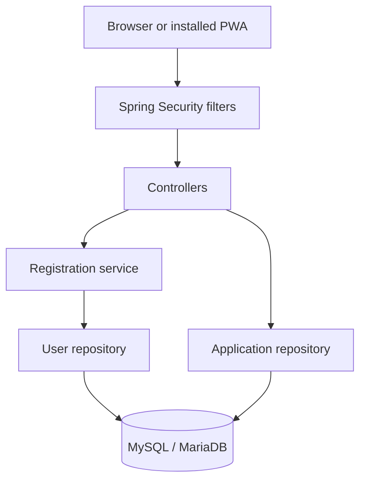

# Job Application Tracker

A full-stack job application tracker built with Java and Spring Boot. Users can register, sign in, and manage their own applications from a responsive web dashboard or an installed Progressive Web App.

**[Open the live app](https://job-application-tracker-kwrn.onrender.com)**

The demo runs on free hosting and may take a little time to wake after inactivity. Create your own account to try it.

## Features

- Registration with server-side validation and bcrypt password encoding.
- Session-based login and logout using Spring Security.
- User-specific applications, with ownership checks on reads, updates, and deletes.
- Add applications with a company and role; change status or delete records.
- Applied, Assessment, Interview, Offer, and Rejected statuses.
- Search by company or role, filter by status, and view status counts.
- Responsive layout and PWA installation on compatible browsers.
- Offline navigation message; application operations require a server connection.

## Technology

| Layer | Technologies |
|---|---|
| Backend | Java 25, Spring Boot 4.1.2, Spring MVC |
| Security | Spring Security, bcrypt, server-side sessions, CSRF tokens |
| Data access | Spring JDBC / JdbcTemplate, parameterized SQL, MariaDB Connector/J |
| Database | MariaDB for local XAMPP development; Aiven MySQL for the hosted app |
| Frontend | HTML, CSS, vanilla JavaScript, Fetch API |
| PWA | Web app manifest, PNG icons, service worker |
| Build and hosting | Maven wrapper, multi-stage Docker build, Render |

## Architecture

Spring Boot serves both the frontend and the API from the same origin.



Registration uses a service to validate inputs and encode passwords. Application CRUD currently goes directly from the controller to its repository.

The backend derives ownership from the authenticated principal, looks up the user's database ID, and uses it in SQL conditions. The client cannot choose an owner ID.

## Run locally

### Requirements

- JDK 25.
- A running MariaDB or compatible MySQL server.
- Git. Maven is downloaded by the included wrapper.

### Setup

```powershell
git clone https://github.com/hilarioussaksham39-spec/Job-Application-Tracker.git
cd Job-Application-Tracker
```

Create the database using your database client:

```sql
CREATE DATABASE IF NOT EXISTS jobtracker
    CHARACTER SET utf8mb4
    COLLATE utf8mb4_unicode_ci;
```

The local defaults connect to MariaDB at localhost:3306/jobtracker with username root and an empty password. These are local development defaults only. To override them, set environment variables in the same PowerShell session:

```powershell
$env:DB_URL = "jdbc:mariadb://localhost:3306/jobtracker"
$env:DB_USERNAME = Read-Host "Database username"
$credential = Get-Credential -UserName $env:DB_USERNAME
$env:DB_PASSWORD = $credential.GetNetworkCredential().Password
Remove-Variable credential
.\mvnw.cmd spring-boot:run
```

Open http://localhost:8080/. Register an account, then log in.

On macOS/Linux, run `sh ./mvnw spring-boot:run` with equivalent environment configuration.

The database must exist before startup. Spring runs `schema.sql` to create missing tables; it does not migrate an existing table when its definition changes.

## Configuration

| Variable | Purpose | Default |
|---|---|---|
| DB_URL | JDBC database URL | Local MariaDB jobtracker database |
| DB_USERNAME | Database username | root |
| DB_PASSWORD | Database password | Empty |
| PORT | HTTP listening port | 8080 |
| FORWARD_HEADERS_STRATEGY | Handling HTTPS proxy headers | none |
| COOKIE_SECURE | Send session cookie only over HTTPS | false |

For the current Render deployment, set FORWARD_HEADERS_STRATEGY=framework and COOKIE_SECURE=true. Keep COOKIE_SECURE=false for plain HTTP localhost development.

For an Aiven connection, use your own endpoint and CA certificate:

```text
jdbc:mariadb://YOUR_HOST:YOUR_PORT/YOUR_DATABASE?sslMode=verify-full&serverSslCert=classpath:aiven-ca.pem
```

Replace `src/main/resources/aiven-ca.pem` with the CA certificate for your service if you fork this project. A CA certificate is public; passwords and private keys must remain outside source control.

Environment variables are read by the process; merely creating a .env file does not automatically load it in this application.

## Database

| Table | Columns |
|---|---|
| users | id, unique username, password_hash |
| applications | id, user_id, company, role, status |

The applications.user_id foreign key references users.id.

## HTTP endpoints

| Method | Path | Purpose |
|---|---|---|
| GET | /api/auth/csrf | Obtain a CSRF token |
| POST | /api/auth/register | Register from a JSON request |
| POST | /login | Spring Security form login |
| POST | /logout | End the authenticated session |
| GET | /api/applications | List the signed-in user's applications |
| POST | /api/applications | Create an application |
| PATCH | /api/applications/{id}/status | Update an owned application's status |
| DELETE | /api/applications/{id} | Delete an owned application |

Login accepts form fields; registration and application writes use JSON. Requests that change data require the CSRF token. The frontend helper in security.js obtains it and adds its header.

## Install the PWA

Open the live app in a compatible browser and use its Install app / Add to Home screen option. On supported browsers it opens in a standalone window.

Local installation can be tested on localhost. Android installation should use the hosted HTTPS URL.

The service worker provides a connection-failure message for navigation. It does not cache private application data or support offline editing, background sync, or notifications.

## Docker deployment

```sh
docker build -t jobtracker .
docker run --rm -p 8080:8080 --env-file YOUR_PRIVATE_ENV_FILE jobtracker
```

Use a database hostname reachable from the container; localhost inside Docker refers to the container itself. Keep the environment file outside Git.

On Render, use a Docker Web Service, the repository-root Dockerfile, and /login.html as the health check path. Configure database credentials in Render's environment settings.

The Docker build uses -DskipTests: it compiles test sources but skips test execution. It runs the packaged application as a non-root user.

## Verification and limitations

During development, manual checks covered registration, duplicate usernames, login/logout, CRUD, persistence, account-specific lists, and cross-account update/delete requests returning 404. The PWA was installed on Android.

The repository currently contains a Spring context smoke test, not a comprehensive automated security or integration test suite. To run it against a configured development database:

```powershell
.\mvnw.cmd test
```

Remaining improvements include automated ownership tests, rate limiting, password recovery, versioned database migrations, pagination, and application dates/notes. This is a portfolio project; it has not undergone a production security audit.

## Project walkthrough

See [the code walkthrough and interview preparation guide](docs/PROJECT_GUIDE.md) for request flows, explanations, practice questions, and resume wording.

